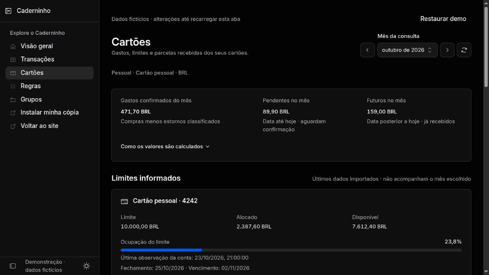
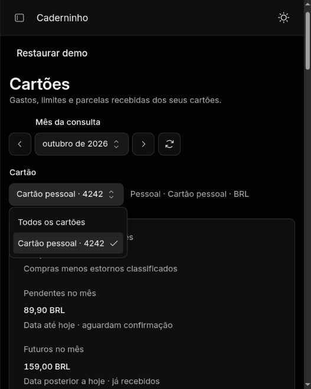
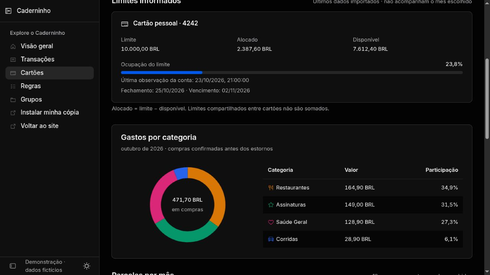
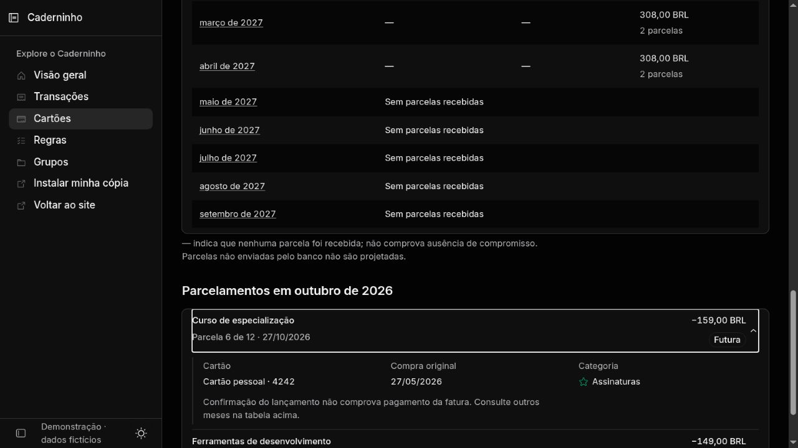
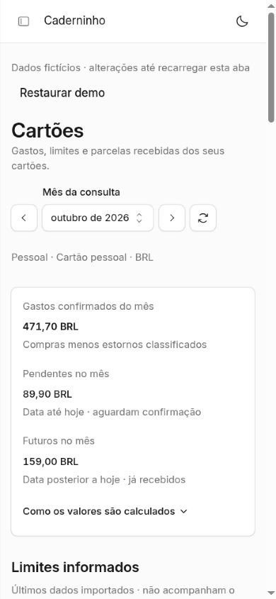
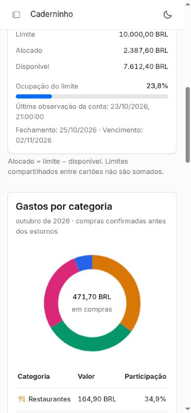

# Revisão de design: Cartões

Revisão local em 24/10/2026, com dados exclusivamente sintéticos. Escopo:
`/account/cards`, com captura dos mesmos componentes em `/demo/cards`.
Direção: Kumo nativo, Inter, conteúdo e controles de Cartões em 14 px.

O loop passou por composição, crítica independente de capturas e nova inspeção
após correções. O designer aprovou os quatro ajustes, sem pendência material
observável nas capturas revisadas: valor/estado das parcelas à direita;
mensagem única nos meses vazios; denominador explícito da rosca; maior peso para
o gasto confirmado no celular. Filtros avançados sem escolhas úteis são omitidos;
o seletor Cartão permanece sempre visível, com Todos os cartões e seleção individual.

1. **Resumo e limite — estável.** Gastos mensais distinguem confirmação,
   pendência e futuro. O limite declara sua base atual, independente do mês.
   O contexto dispensa pessoa de opção única. O cartão é selecionado diretamente
   na barra, preservando os demais filtros e reiniciando a paginação.

   

   O seletor Cartão fica sempre visível, inclusive com uma conta. Selecionar uma
   conta e voltar para Todos os cartões foi exercitado no navegador; os links
   mensais mantêm a seleção. O designer conferiu descoberta e legibilidade na
   largura efetiva de 527 px. O menu usa texto de 14 px, conferido no DOM.

   

2. **Categorias — estável.** Rosca usa as cores cadastradas e mostra seu
   denominador exato de compras confirmadas antes dos estornos. A tabela
   conserva valores e participações quando o gráfico não pode ser exibido.

   

3. **Parcelas e detalhe — estável.** Os 12 meses preservam seus links, e meses
   sem lançamentos têm uma única mensagem. O gatilho ocupa toda a largura.
   Enter abriu os detalhes da parcela e manteve o foco visível; a compra
   original não é confundida com pagamento da fatura.

   

4. **Resumo no celular — estável.** Conteúdo de 14 px, valor confirmado com
   peso 600 e informação secundária com peso 500. A versão clara mantém os
   controles e a hierarquia da versão escura.

   

5. **Categorias no celular — estável.** Rosca e legenda empilham. As larguras
   de viewport de 390 e 320 px não produziram rolagem horizontal na página ou
   no conteúdo. A troca para novembro exibiu zero confirmado e 308,00 BRL
   futuros, conservando o limite atual; voltar a outubro restaurou o recorte.

   

## Limites da evidência

As capturas não representam uma conexão real, dados privados, estornos, várias
moedas ou limites ausentes. Testes de domínio, renderização e integração cobrem
essas regras financeiras e a ausência de limite, sem substituir a validação
visual de todos os estados. A expansão por Enter foi exercitada; não houve
auditoria completa de Tab, leitor de tela, zoom de 200% ou contraste medido.

Não houve deploy, migração remota, autenticação com um banco real, OAuth de
assistente ou validação de host MCP. A entrega é uma proposta em PR draft com
preview local e evidência sintética.
