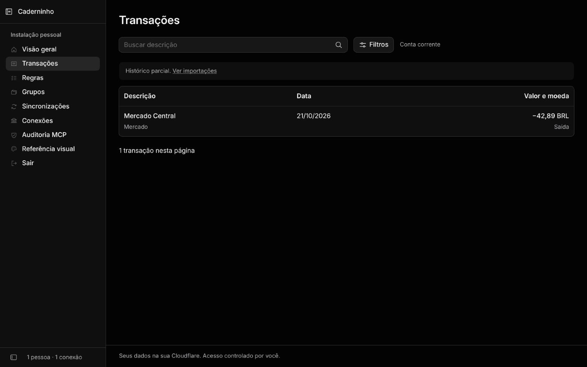
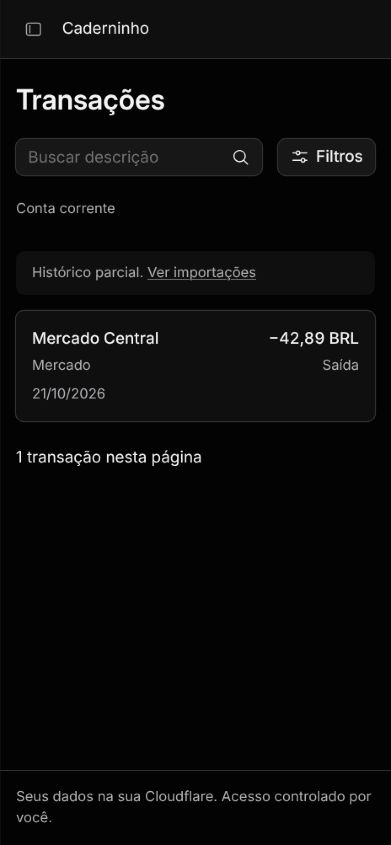
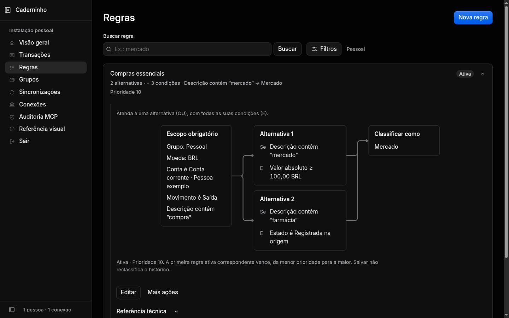
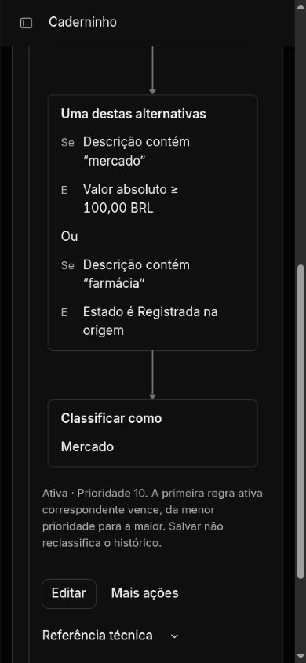
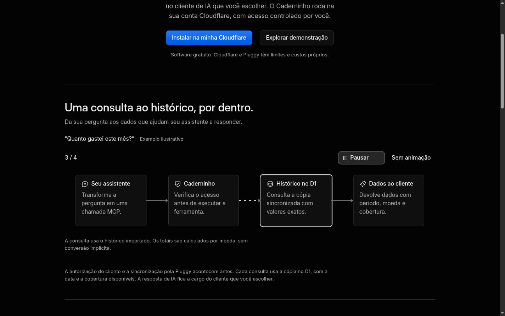
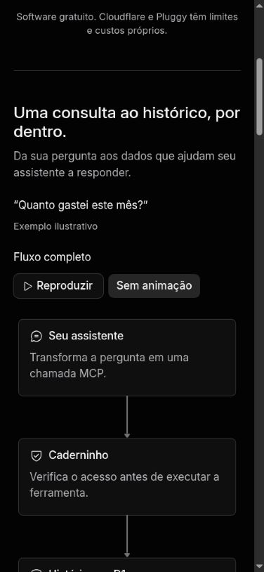
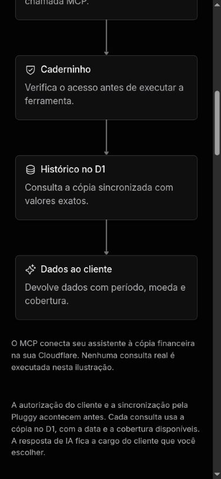
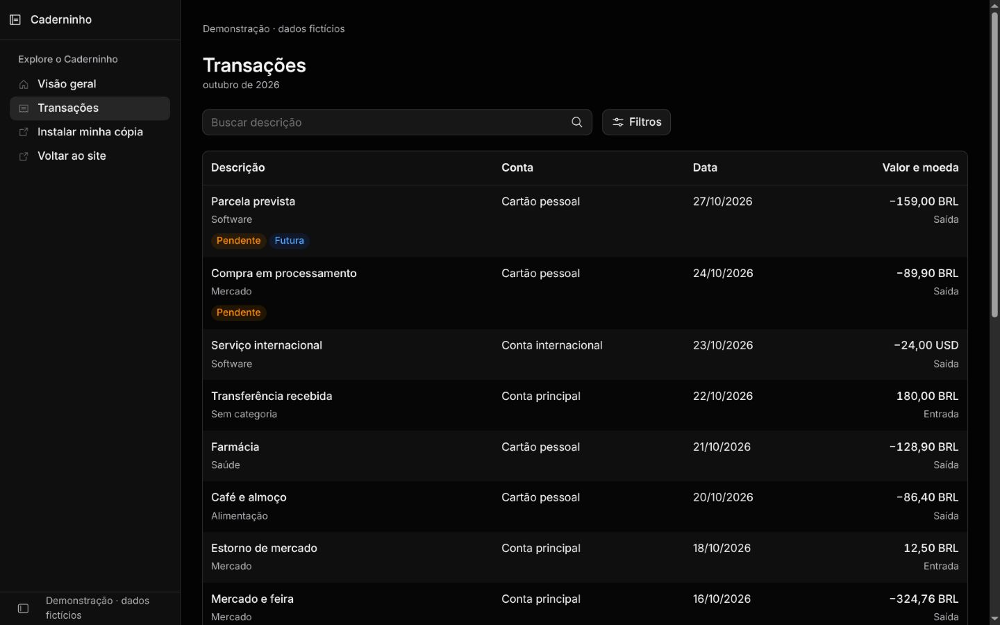
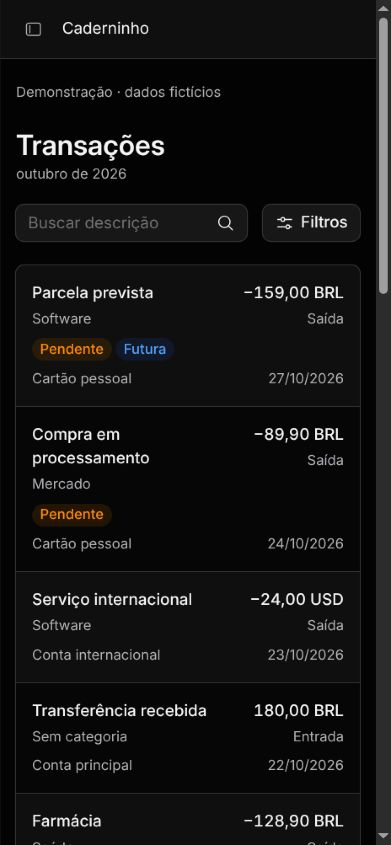

# Galeria final — Caderninho com Kumo

Capturas reais da implementação local, com dados fictícios. Desktop e celular.

[Galeria atual da rodada 08:14 páginas/grades/estados](capturas/rodada-08/README.md) ·
[revisão independente](revisao-critica-08-polimento.md). As imagens abaixo registram
rodadas anteriores; o índice08 identifica o acabamento atual.
[Revisão 03 por página](revisao-critica-03.md) · [revisão 04 de Transações](revisao-critica-04-transacoes.md) · [estados e grades](capturas/README.md).

## Visão geral

`/account`

## Transações

`/account/transactions`

Uma conta: contexto único, sem seletor nem coluna repetida. Rodada 04.

## Regras

`/account/rules`

Composição expandida com Flow real. Lista recolhida permanece compacta. Rodada 07.

## Grupos

`/account/groups`

## Sincronizações

`/account/sync`

## Conexões

`/account/connections`

## Auditoria MCP

`/account/audit`

## Referência visual

`/account/design-system`

## Landing

`/`

Rodada 05 acrescentou uma explicação MCP com Flow real e reprodução controlada.
Estas são capturas de estados; [movimento e limites](motion.md).

As imagens abaixo mostram o restante da landing na rodada 03, anterior à nova seção.

## Acesso

`/account/login`

## Consentimento

`/authorize`

## 404

`/pagina-inexistente`

## Demo pública

`/demo?month=2026-10`

## Demo de Transações

`/demo/transactions?month=2026-10`

